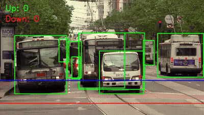
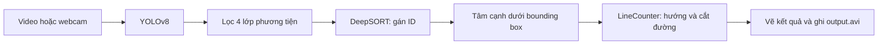

# TrafficVision — Phát hiện, theo dõi và đếm phương tiện

Hệ thống xử lý video giao thông bằng **YOLOv8 + DeepSORT**, gán ID cho phương tiện và đếm lượt di chuyển lên/xuống qua hai đường ngang. Phù hợp để tìm hiểu pipeline thị giác máy tính từ phát hiện đối tượng đến phân tích quỹ đạo.



**[Xem video kết quả MP4](docs/media/traffic-demo.mp4)** · [Ảnh kết quả](docs/media/traffic-preview.jpg) · [Nguồn và cách tạo minh họa](docs/media/README.md)

Ảnh/video là kết quả chạy mô hình thật trên một đoạn video đường phố, không phải hình dựng. Đây là minh họa hoạt động, chưa phải đánh giá độ chính xác trên tập dữ liệu có nhãn.

## Chức năng hiện có

| Thành phần | Cách thực hiện trong mã nguồn |
| --- | --- |
| Phát hiện | Nạp trọng số `yolov8n-seg.pt` đã có trong kho |
| Lọc phương tiện | Giữ các lớp COCO: car `2`, motorcycle `3`, bus `5`, truck `7` |
| Theo dõi | `DeepSort(max_age=30)`; chỉ dùng track đã được xác nhận |
| Điểm tham chiếu | Tâm cạnh dưới bounding box: `((left + right) / 2, bottom)` |
| Đếm | `LineCounter` theo dõi thứ tự cắt hai đường và hướng dịch chuyển |
| Hiển thị | Bounding box, ID, điểm tham chiếu, hai đường đếm, tổng `Up`/`Down` |
| Xuất kết quả | `output.avi`, codec XVID, tốc độ ghi cố định 20 FPS |

Mặc dù trọng số là mô hình segmentation, chương trình hiện chỉ sử dụng bounding box; chưa vẽ hoặc phân tích mask. Các loại xe được gom thành `vehicle`, chưa có thống kê riêng từng loại.

## Pipeline



## Cài đặt

Cần Python, Git và môi trường desktop có thể mở cửa sổ OpenCV. **Python 3.11** và bộ thư viện dưới đây là cấu hình đã dùng để tạo demo trên CPU Windows. GPU không bắt buộc; lần chạy đầu DeepSORT có thể tải trọng số MobileNet và cần Internet.

```bash
git clone https://github.com/thanq204/TrafficVision.git
cd TrafficVision
python -m venv .venv
```

Kích hoạt môi trường:

```powershell
# Windows PowerShell
.\.venv\Scripts\Activate.ps1
```

```bash
# Linux / macOS
source .venv/bin/activate
```

Cài bộ thư viện tương thích với phiên bản YOLOv8 cũ của dự án:

```bash
python -m pip install --upgrade pip
python -m pip install torch==2.5.1 torchvision==0.20.1 --index-url https://download.pytorch.org/whl/cpu
python -m pip install -r requirements.txt "numpy==1.26.4" "opencv-python==4.10.0.84" "deep-sort-realtime==1.3.2" "setuptools<81"
```

`requirements.txt` hiện chưa khai báo `deep-sort-realtime`, dù `main.py` có import thư viện này; lệnh trên cài bổ sung. DeepSORT cần `pkg_resources`, vì vậy dùng `setuptools<81`. Với GPU, cài bộ PyTorch/torchvision tương thích CUDA của máy thay cho lệnh CPU.

## Chuẩn bị video và chạy

1. Tạo thư mục `data/` tại thư mục gốc dự án.
2. Đặt video tại **`data/east.mp4`**. Video đầu vào không được đưa vào kho Git.
3. Chạy từ thư mục có `main.py` và `yolov8n-seg.pt`:

```bash
python main.py
```

Cửa sổ **Traffic System** hiển thị kết quả. Nhấn **Esc** để dừng; `output.avi` được ghi trong thư mục hiện tại và bị ghi đè khi chạy lại.

Nếu không mở được `data/east.mp4`, mã tự thử webcam `0`. Muốn chọn video khác hoặc chủ động dùng webcam, sửa biến trong `main.py`:

```python
source = "data/my_video.mp4"  # video khác
# source = 0               # webcam mặc định
```

Chương trình chưa có tham số dòng lệnh cho đường dẫn video. File AVI được ghi ở 20 FPS bất kể FPS đầu vào; thời lượng phát lại có thể khác video gốc.

## Cách đếm Up / Down

Hai đường ngang mặc định nằm tại:

```python
line1 = int(height * 0.7)  # 70% chiều cao, tính từ mép trên
line2 = int(height * 0.9)  # 90% chiều cao
counter = LineCounter(line1, line2, min_frames=2)
```

- **Down:** điểm tham chiếu đi xuống, cắt `line1` rồi `line2`.
- **Up:** điểm tham chiếu đi lên, cắt `line2` rồi `line1`.
- Logic bổ sung cho phép track xuất hiện giữa hai đường được đếm khi cắt đường thoát theo hướng tương ứng.
- Mỗi ID chỉ được đếm một lần trong phiên chạy nhờ tập `counted`.
- Phép kiểm tra dùng vị trí trước/sau để phát hiện việc cắt đường, kể cả khi điểm không nằm đúng trên đường ở một frame.

`Up`/`Down` là hướng theo trục dọc **trong ảnh**. Ý nghĩa đi đến/đi xa camera phụ thuộc góc đặt camera; hệ thống không đo vận tốc hoặc hướng địa lý.

## Điều chỉnh cho camera của bạn

| Cần thay đổi | Vị trí |
| --- | --- |
| Nguồn video | `source` trong `main.py` |
| Vị trí đường đếm | Hai hệ số `0.7` và `0.9`; giữ `line1 < line2` |
| Loại phương tiện | Danh sách `[2, 3, 5, 7]` trong vòng lặp detection |
| Thời gian giữ track mất dấu | `DeepSort(max_age=30)`, tính bằng frame |
| Số lần cập nhật tối thiểu trước khi đếm | `LineCounter(..., min_frames=2)` |
| Đầu ra | `cv2.VideoWriter(...)`: tên file, codec, FPS |

Nên dùng camera cố định, đặt đường đếm ở vùng xe còn nhìn rõ và kiểm tra thủ công một đoạn video trước khi dùng số liệu.

## Cấu trúc thư mục

```text
TrafficVision/
├── main.py                    # Pipeline đang sử dụng
├── requirements.txt
├── yolov8n-seg.pt              # Trọng số YOLO có sẵn
├── src/
│   ├── analytics/counter.py    # LineCounter và trạng thái từng ID
│   ├── tracking/tracker.py     # CentroidTracker thay thế, main.py chưa dùng
│   └── utils/visualization.py  # Hàm vẽ hỗ trợ, main.py đang tự vẽ
├── docs/media/                # Ảnh/video demo và thông tin nguồn
└── data/east.mp4               # Người dùng tự cung cấp; được Git bỏ qua
```

## Giới hạn hiện tại

- Chưa có benchmark với nhãn thật, nên chưa công bố accuracy, precision/recall hoặc sai số đếm. Tốc độ xử lý phụ thuộc máy, độ phân giải và số phương tiện.
- Che khuất, mất dấu hoặc đổi ID có thể dẫn đến thiếu/đếm trùng. Lịch sử track và tập ID đã đếm chưa được dọn theo thời gian, cần lưu ý với video dài.
- Detection được chuyển cho DeepSORT với confidence cố định `1.0` và nhãn chung `vehicle`; chưa truyền confidence gốc của YOLO.
- Khi tổng đếm thay đổi, code hiện đánh dấu highlight cho mọi ID đang có; màu đỏ chưa xác định riêng chính xác xe vừa được đếm.
- Chưa có đếm theo làn, đo tốc độ, nhận diện biển số, API/web dashboard hoặc xuất thống kê CSV.

## Xử lý lỗi thường gặp

| Hiện tượng | Cách kiểm tra |
| --- | --- |
| `No module named 'deep_sort_realtime'` | Cài `deep-sort-realtime` trong đúng môi trường Python |
| `No video` hoặc mở webcam ngoài ý muốn | Kiểm tra `data/east.mp4`, đường dẫn chạy và khả năng đọc codec |
| Lỗi NumPy/torchvision hoặc tải checkpoint | Dùng bộ phiên bản trong phần cài đặt; không tự nâng riêng torch với YOLOv8 cũ |
| Lỗi `imshow` trên máy chủ | `main.py` cần desktop; dùng môi trường có GUI hoặc điều chỉnh phần hiển thị cho chế độ headless |
| Không thấy xe được đếm | Kiểm tra xe có cắt đường ở 70%/90% chiều cao và track đã được xác nhận chưa |

## Tác giả và tài nguyên

**Nguyen Chien Thang** · [GitHub: thanq204](https://github.com/thanq204)

Thư viện chính: [Ultralytics](https://github.com/ultralytics/ultralytics), [Deep SORT Realtime](https://github.com/levan92/deep_sort_realtime), [OpenCV](https://opencv.org/). Nguồn và giấy phép của video minh họa được ghi riêng tại [docs/media/README.md](docs/media/README.md).
