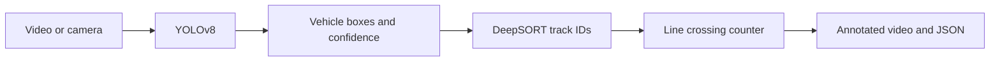

# TrafficVision | Vehicle Detection, Tracking and Counting

TrafficVision runs a pretrained **YOLOv8** detector and **DeepSORT** tracker on a video or camera stream. It counts vehicles crossing two configurable lines, exports an annotated video, and reports the totals as JSON. It can run on a desktop or from the command line without a display.


[Xem video MP4](docs/media/traffic-demo.mp4) · [Ảnh kết quả](docs/media/traffic-preview.jpg) · [JSON](docs/media/summary.json) · [Nguồn và cách tái tạo](docs/media/README.md)

## Demo đã chạy

| Đầu vào | Đầu ra |
| --- | --- |
| 12 giây video đường phố, 768 × 432 | 240 khung hình, 20 FPS |
| Hai đường ở 70% và 90% chiều cao ảnh | 2 lượt Up và 4 lượt Down do hệ thống ghi nhận |
| Trọng số YOLOv8n-seg có sẵn | Bounding box, ID, video AVI và báo cáo JSON |

Đây là kết quả suy luận trên một clip minh họa. Clip chưa có nhãn đếm chuẩn để đo sai số.

## Cài đặt và chạy

Dùng Python 3.11. Từ thư mục gốc repo, tạo và kích hoạt môi trường ảo rồi chạy:

```bash
python -m pip install torch==2.5.1 torchvision==0.20.1 --index-url https://download.pytorch.org/whl/cpu
python -m pip install -r requirements.txt
```

Với video của bạn, chạy không cần cửa sổ:

```bash
python main.py --source data/east.mp4 --headless --device cpu --output data/result.avi --summary data/result.json
```

Để xem trực tiếp, bỏ `--headless` và nhấn **Esc** để dừng. Dùng `--source 0` cho webcam. Lệnh `python main.py` mặc định thử `data/east.mp4` rồi đến webcam 0 nếu video không mở được. Repo không kèm video đầu vào mặc định. Khi chỉ định `--source`, nguồn không đọc được sẽ báo lỗi để tránh mở nhầm camera.

| Tùy chọn | Mặc định / ý nghĩa |
| --- | --- |
| `--source` | Video, URL hoặc số camera |
| `--weights` | `yolov8n-seg.pt` |
| `--device` | Ultralytics tự chọn nếu bỏ qua. Dùng `cpu` cho CPU |
| `--line-top` / `--line-bottom` | `0.7` / `0.9`, tính từ mép trên |
| `--output` | `output.avi`. Ghi XVID với FPS nguồn, hoặc 20 nếu nguồn không báo FPS |
| `--summary` | File JSON tùy chọn. Tổng đếm cũng in ra terminal |
| `--headless` | Tắt cửa sổ hiển thị, vẫn ghi video |

## Pipeline



- YOLOv8 lọc bốn lớp COCO gồm car, motorcycle, bus và truck. Trọng số segmentation được dùng để lấy bounding box và độ tin cậy.
- DeepSORT gán ID. Hệ thống đếm dựa trên tâm cạnh dưới của các box thuộc track đã xác nhận và vừa được cập nhật.
- `Down` tăng khi xe di chuyển xuống qua đường đích, `Up` tăng khi đi lên. Một ID chỉ được đếm một lần. Quy tắc cho phép xe xuất hiện giữa hai đường được đếm khi cắt đường thoát.
- Box xanh là track đang theo dõi, box cam là track đã được đếm. Hướng đếm phụ thuộc trục dọc của ảnh và vị trí camera.

## Mã nguồn và giới hạn

| File | Vai trò |
| --- | --- |
| [main.py](main.py) | CLI, suy luận, tracking, vẽ và xuất kết quả |
| [src/analytics/counter.py](src/analytics/counter.py) | Quy tắc đếm, trạng thái theo track ID |
| [docs/media/README.md](docs/media/README.md) | Ghi công nguồn và lệnh tạo demo |

Kết quả phụ thuộc góc camera, che khuất và độ ổn định của track ID. Điều chỉnh hai đường cho từng góc quay trước khi dùng tổng đếm. Các ID và lịch sử được giữ trong bộ nhớ trong suốt phiên chạy. Demo dùng trọng số có sẵn và chưa có benchmark độ chính xác hoặc tốc độ suy luận.

Nguyen Chien Thang · [GitHub](https://github.com/thanq204)
